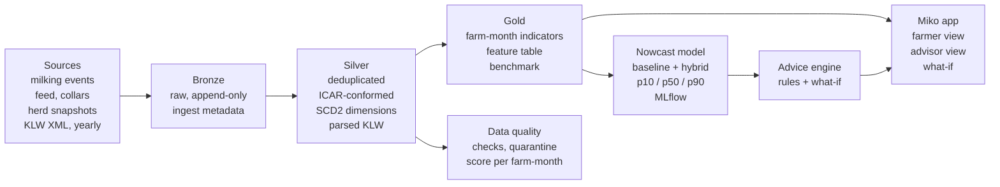

# Miko: Design Document

**Know your farm's footprint before the year is over.**

| | |
|---|---|
| Version | 0.1 |
| Date | 31 October 2026 |
| Author | Ali Baghdadi |
| Repository | `miko-sustainability-nowcast` |
| Status | Draft, before Phase 0 |

---

## Contents

1. [Summary](#1-summary)
2. [Background and problem](#2-background-and-problem)
3. [Goals and non-goals](#3-goals-and-non-goals)
4. [Users and stories](#4-users-and-stories)
5. [Indicators and formulas](#5-indicators-and-formulas)
6. [Data sources (synthetic)](#6-data-sources-synthetic)
7. [Architecture](#7-architecture)
8. [Data model](#8-data-model)
9. [Prediction design](#9-prediction-design)
10. [Advice and what-if](#10-advice-and-what-if)
11. [Dashboard](#11-dashboard)
12. [Privacy and data governance](#12-privacy-and-data-governance)
13. [Data quality](#13-data-quality)
14. [Engineering practices](#14-engineering-practices)
15. [Project phases](#15-project-phases)
16. [Success criteria](#16-success-criteria)
17. [Risks and limitations](#17-risks-and-limitations)
18. [Glossary](#18-glossary)
19. [Sources](#19-sources)

---

## 1. Summary

**Miko** uses daily data from dairy robots to:

1. **estimate now** (nowcast) the farm's yearly environmental numbers from the **KringloopWijzer (KLW)**,
2. **predict the end of the year** (forecast), with a range, and
3. **suggest one or two simple actions** to the farmer.

| Question | Short answer |
|---|---|
| **Problem** | The KLW report comes once a year, late (up to 15 May of the next year). It is 28 pages long, hard to read, and gives no actions. |
| **Solution** | Monthly estimates, an end-of-year forecast with an uncertainty range, and one or two clear actions a week. |
| **Main user** | The dairy farmer. Second user: the farm advisor. |
| **Data** | Synthetic but realistic: milking and feeding robots, collars, herd data, and KLW-style XML files. |
| **Tech** | Local: Python (conda), PySpark, Delta Lake, MLflow, Streamlit, Jenkins in Docker. Cloud: Databricks, Unity Catalog, Azure, Terraform. |
| **Fictional company** | **Bayal Dairy Robotics** |

---

## 2. Background and problem

The problem is inspired by a real project brief from a dairy-robotics company. This project uses a **fictional company** and does not use any real company's name, logo, products or data.

### 2.1 The fictional company: Bayal Dairy Robotics

- A fictional Dutch company that builds milking robots, feeding robots and cow collars.
- The name comes from **Bayal**, the village in Dariush Mehrjui's film *The Cow* (1969), a story about a farmer's deep bond with his cow.
- Fictional products: **Bayal Milker** (milking robot), **Bayal Feeder** (feeding robot), **Bayal Collar** (cow collar), and **Bayal Farm** (farm management software).
- **Miko** is a new module inside Bayal Farm. (Miko is named after my cat.)

### 2.2 What is the KringloopWijzer?

| Feature | Details |
|---|---|
| What | A Dutch tool that calculates a farm's nutrient cycles (nitrogen, phosphate, carbon) and its environmental and climate performance |
| Owner | ZuivelNL, with scientific support from Wageningen University & Research (WUR) |
| Who must use it | Almost every Dutch dairy farm (all farms that deliver milk to NZO dairy companies) |
| Deadline | **15 May**, for the **previous year** |
| How often | **Once a year** |
| Automatic inputs | RVO (animals, manure, fields), dairy company (milk), feed suppliers, labs (silage, soil), through **JoinData** with the farmer's permission |
| Output | **XML** files and a 28-page report |
| Calculation rules | "**Rekenregels**" that **change every year**. Example: in 2024, greenhouse gases went up by **13%** on average, because emissions from peat soil were added |

### 2.3 Why it matters to farmers

- **Money:** dairy companies pay a **sustainability bonus** based on KLW results.
- **BEX:** the farm's own nitrogen and phosphate excretion. Lower BEX means less manure the farmer must pay to remove.
- **End of derogation (1 January 2026):** every farm now has a limit of **170 kg nitrogen from animal manure per hectare**. Manure removal costs more, so nitrogen efficiency is now directly about money.

### 2.4 Four gaps

| Gap | Today | With Miko |
|---|---|---|
| **1. Time** | Once a year, up to 16 months late | **Monthly** estimate + end-of-year forecast |
| **2. Understanding** | 28 pages, complex XML | **3 to 5 numbers** with green, amber or red lights |
| **3. Action** | No actions suggested | **One or two actions**, each with an estimated effect |
| **4. Connection** | Nobody has tested how robot data relates to KLW results | Miko **models and tests** this link |

### 2.5 The key insight

A large part of the KLW results (especially BEX, ammonia and part of the greenhouse gases) is calculated from **feed** and **milk**. Robots measure exactly these things **every day**.

So we can use **leading indicators** (like milk urea and ration protein) to estimate the **lagging indicators** (the yearly KLW results) much earlier. This is called **nowcasting**. Central banks do the same with GDP: the official number comes late, so they estimate it now from faster data.

---

## 3. Goals and non-goals

The main goal: build a **complete, professional system** from raw data to a clear action. It should solve a real problem and show the skills of a data engineer.

### Goals

| ID | Goal | How we know it is done |
|---|---|---|
| G1 | A **realistic data generator** for many farms and years, with planned data problems | One command makes the same data again with the same seed |
| G2 | A **medallion pipeline** (Bronze, Silver, Gold) with PySpark and Delta Lake | Running it twice gives the same result (idempotent) |
| G3 | **Parse KLW-style XML** with different versions of the rules | Every KLW number is stored with its rules version |
| G4 | **Monthly indicators** for each farm | A Gold table with documented and tested formulas |
| G5 | **Forecast** the yearly indicators with an **uncertainty range** | Beats the baseline in a backtest (section 16) |
| G6 | **Advice and what-if** | Each piece of advice has one action, one estimated effect, one confidence level |
| G7 | A **simple dashboard** for farmers and advisors | The farmer view shows at most 5 numbers and works offline |
| G8 | **Privacy built into the data model** (consent) | Each user only sees data they are allowed to see |
| G9 | **Engineering quality**: tests, CI, docs, decision records (ADRs) | CI is green, README is complete |
| G10 | **Move to the cloud** (Databricks + Azure) with the same code | The same pipeline runs in the cloud with Asset Bundles and Terraform |

### Non-goals

- **Not the official KLW calculation.** Miko only **estimates**. It does not replace the KringloopWijzer.
- **No real farm data.** All data is synthetic, and the README says so clearly.
- **No legal or veterinary advice.** Advice is a concept, written in careful language.
- **No mobile app.** Web dashboard only.
- **No computer vision (cameras).**
- **No sub-second streaming.** Robot data arrives in **micro-batches**, which is enough for daily decisions.
- **No detailed model of soil, fertiliser and crops.** These exist only in the generator's "reference engine" (section 6), to create a real gap between robot data and KLW.

---

## 4. Users and stories

There are three users with different needs. These personas are **assumptions** and should be tested by talking to real farmers or advisors.

| Persona | Who | Main question | What they want from Miko |
|---|---|---|---|
| **Jan** (traditional farmer) | 58, 120 cows, sandy soil. Low digital skills. His advisor fills in the KLW | "Will I get the sustainability bonus this year?" | A green, amber or red light and **one thing to do** this week |
| **Sanne** (data-driven farmer) | 34, 220 cows, clay soil. Checks the farm app every day | "If I change the ration, how much does ammonia go down?" | Trends, **what-if**, comparison with similar farms |
| **Pieter** (advisor) | Feed and sustainability advisor, 40 client farms | "Which client should I call first?" | A list of farms at risk, details, data quality (only with the farmer's permission) |

### User stories

1. As a **farmer**, I want to see where I am this year compared with last year's KLW and the target, so I know if I should worry.
2. As a **farmer**, I want to know what my KLW will probably be this year, so I still have time to change things before the year ends.
3. As a **farmer**, I want to see **at most two concrete actions** each week, with their estimated effect, so I know where to start.
4. As a **farmer**, I want to decide who can see my data, so I stay in control.
5. As a **data-driven farmer**, I want to try a change (for example, ration protein) and see its effect.
6. As an **advisor**, I want to see first the farms that will probably miss their targets.
7. As **any user**, I want to know how much I can **trust** a number (data quality and uncertainty range).

### User research questions (if you talk to a farmer or advisor)

- How do you read the KLW report? Which number do you look at first?
- What decisions have you made because of it?
- Which numbers can you change **every week**? Which only once a year?
- If you get an alert, what makes you trust it?
- What worries you about sharing data with an advisor or a dairy company?

---

## 5. Indicators and formulas

Miko uses **8 leading indicators** (daily and monthly) to estimate and forecast **4 target indicators** (yearly, like the KLW).

### 5.1 Target indicators (what we forecast)

| ID | Indicator | Unit | Reference target | Dutch average (2020) |
|---|---|---|---|---|
| T1 | Ammonia per hectare | kg NH3/ha | 50 to 60 | 51.3 |
| T2 | Nitrogen soil surplus | kg N/ha | about 125 (clay and sand) | 181 |
| T3 | Greenhouse gases | kg CO2-eq/kg FPCM | 1.3 to 1.4 | 1.45 |
| T4 | Herd nitrogen excretion (BEX-like) | kg N/cow/year | below the standard | - |

### 5.2 Leading indicators (from daily data)

| ID | Indicator | Unit | Source | Why it matters |
|---|---|---|---|---|
| L1 | Fat and protein corrected milk (FPCM) | kg/cow/day | Milking robot | Denominator of T3 |
| L2 | Tank milk urea | mg/100 g | Dairy company milk analysis (every 3 days) | Signal of **nitrogen efficiency**. High urea = more nitrogen in urine = more ammonia |
| L3 | Ration crude protein (CP) | g/kg DM | Feeding robot + lab analysis | The most important lever the farmer controls |
| L4 | Feed efficiency | kg FPCM/kg DM | Milking robot + feeding | Less feed for the same milk = fewer emissions |
| L5 | Concentrate per 100 kg milk | kg/100 kg | Milking robot (feed in the robot) | Bought feed = imported nitrogen |
| L6 | Herd nitrogen use efficiency | % | Calculated (below) | How much feed nitrogen ends up in milk |
| L7 | Grazing hours | hours/cow/day | Collar | Ammonia on pasture is lower than in the barn |
| L8 | Young stock ratio | heifers per 10 dairy cows | Farm software | Young stock eat and emit, but give no milk |

### 5.3 Formulas (simple and public)

**FPCM** (IDF standard):

```
FPCM (kg) = milk (kg) × (0.1226 × fat% + 0.0776 × protein% + 0.2534)
```

**Nitrogen in milk** (milk protein divided by 6.38):

```
N_milk (kg) = milk (kg) × protein% / 100 / 6.38
```

**Nitrogen intake from feed** (crude protein divided by 6.25):

```
N_intake (kg) = DMI (kg) × CP (g/kg DM) / 1000 / 6.25
```

**Nitrogen excretion** (the core of T4):

```
N_excreted = N_intake - N_milk - N_retained
```

**Herd nitrogen efficiency (L6) and feed efficiency (L4):**

```
NUE_herd (%) = N_milk / N_intake × 100
FE = FPCM / DMI
```

**Ammonia (Miko's simple version):** part of the excreted nitrogen escapes as ammonia, with different factors in the barn and on pasture:

```
NH3 = 17/14 × (N_excreted_barn × EF_barn + N_excreted_pasture × EF_pasture)
```

**Greenhouse gases (Miko's simple version):** methane from digestion (based on DMI) + manure + feed production + energy, divided by FPCM.

> The factors (EF) are in a config file (`config/factors.yaml`) and are **versioned**. They are **not the official KLW rules**, only a simple and documented approximation. Robots cannot see T2 (nitrogen soil surplus) at all, because it depends on soil, fertiliser and crops. So T2 is estimated only with the ML model.

---

## 6. Data sources (synthetic)

A **farm simulator** creates all the data. The key design idea: the simulator has a **"hidden truth"** that Miko cannot see.

### 6.1 The main idea: hidden truth

1. For each farm, the simulator creates a **complete, true state**: cows, feed, soil, fertiliser, crops, weather, and some hidden factors (like the farmer's "management skill").
2. From this truth, two things come out:
    1. **Observable data** (like robot data), with noise and problems.
    2. **The yearly KLW result**, made by a **"reference engine"** that sees everything (including soil and fertiliser), with rules that change by year.
3. Miko only sees 2.1 and **the KLW results of earlier years**.

**Why this matters:** the model cannot just memorise the generator's formula. There is a real gap, like in the real world. This answers the question "*Your model just learned your own generator, right?*"

### 6.2 Sources

| ID | Source (fictional) | Grain | Frequency | Format | Main fields |
|---|---|---|---|---|---|
| S1 | Milking robot (Bayal Milker) | One cow × one milking | Continuous, about 2.8 per day | JSON Lines, like ICAR MilkingVisitEvent | event_id, farm_id, cow_id, robot_id, start/end time, milk_kg, fat_pct, protein_pct, lactose_pct, conductivity, milk_temp, concentrate_kg, device_time, sent_time |
| S2 | Feeding robot (Bayal Feeder) | Cow group × one delivery | Several times a day | JSON Lines | event_id, farm_id, group_id, ration_id, fed_kg_fresh, timestamp, refusal_kg (leftovers) |
| S3 | Feed analysis (lab) | Ration or silage | A few times a year | CSV | ration_id, sample_date, dm_pct, cp_g_per_kg_dm, vem, ndf |
| S4 | Tank milk analysis (dairy company) | Farm × one pickup | Every 3 days | CSV | farm_id, pickup_date, litres, fat, protein, **urea_mg_100g**, scc |
| S5 | Collar (Bayal Collar) | Cow × day | Daily | Parquet | cow_id, date, rumination_min, activity_index, grazing_min |
| S6 | Farm software (Bayal Farm) | Cow, group | **Daily snapshot** (for CDC) | CSV | cow_id, birth_date, lactation_no, calving_date, group_id, status (milking, dry, heifer), exit_date |
| S7 | Farm master data | Farm | Sometimes (SCD2) | CSV | farm_id, region, soil_type (sand, clay, peat), area_ha, grassland_ha, maize_ha, has_feeder |
| S8 | **KLW XML** | Farm × year | Yearly, by 15 May of the next year | XML, KLW-like structure | farm ID, year, rules version, sections for herd, feed, manure, soil, emissions, and indicators T1 to T4 |
| S9 | Consents (JoinData-like) | Farm × grantee × purpose | When the farmer changes them | CSV | farm_id, grantee, purpose, valid_from, valid_to |
| S10 | Weather (optional, later) | Region × day | Daily | CSV | Temperature, rain. Could be **real public KNMI data** |

### 6.3 Data size

| Profile | Farms | Years | Milking events (about) | Use |
|---|---|---|---|---|
| `tiny` | 2 | 1 month | ~15 thousand | Integration tests in CI |
| `dev` | 5 | 1 | ~600 thousand | Daily development, fast tests |
| `full` | 60 | 2023 to 2025 + 2026 to today | ~25 million | Modelling, showing what Spark can do |

### 6.4 Planned data problems (like the real world)

| Problem | Example | Where it is fixed |
|---|---|---|
| Duplicate events | The robot sends the same event again after a network cut | Silver (dedup on event_id) |
| Late data | The farm was offline for 3 days | Silver (recompute the affected days) |
| Out of order | sent_time does not match device_time | Silver (always use event time) |
| Wrong clock | One robot's clock is 2 hours ahead | Data quality + correction |
| Impossible value | 80 kg milk in one milking, 0% fat | Quarantine |
| Wrong unit | Protein as 0.034 instead of 3.4 | Fix rule + log |
| Missing data | A farm has no feeding robot | "Missing data" mode + wider range |
| ID change | A cow moves to another farm | SCD2 in dim_cow |
| XML structure change | A new KLW version adds or renames a field | Version-aware parser |
| Rule change | From 2024, peat emissions are added | dim_rekenregels (SCD2) |

Each problem has a **configurable rate** in `config/generator.yaml`, so tests can prove the pipeline finds all of them.

### 6.5 Calibrating with the real world

- Averages close to the Netherlands: about 9,000 kg milk per cow per year, T1 about 51, T2 about 180, T3 about 1.45.
- Milking record structure from the public Wageningen dataset (Zenodo).
- Field names and event structure from the ICAR ADE standard.
- XML structure from the public "Data Uitvoergegevens KLW" specification (to download and check).
- Lactation curve checked against the small real Guelph dataset (5 cows).

---

## 7. Architecture

The architecture is a **medallion** design (Bronze, Silver, Gold), the usual pattern in Databricks. **The same code** runs locally first, then in the cloud.



Across all layers: consent filters, lineage, tests, CI, Terraform.

### 7.1 The layers in simple words

| Layer | What it does | Golden rule |
|---|---|---|
| **Landing** | A folder where the generator drops raw files (like files arriving from farms) | Never changed |
| **Bronze** | Keeps the data **exactly as it came**, plus file name and arrival time | Append only, so everything can be rebuilt |
| **Silver** | Removes duplicates, fixes types, uses ICAR names, parses XML, keeps history (SCD2) | Each event once, each value with the right unit |
| **Gold** | Daily and monthly indicators, model features, forecasts, advice | Ready for the dashboard |

### 7.2 Tools: local and cloud

| Job | Local (Phases 0 to 7) | Cloud (Phase 8) | Why |
|---|---|---|---|
| Language | Python 3.11 (object-oriented), from a **conda** environment (`environment.yml`), packages pinned in `pyproject.toml` | Same | Matches real data engineer job ads; same versions on laptop and Jenkins |
| Processing | PySpark 4.0 in the conda environment on Ubuntu (WSL), Java 17 from conda, ANSI mode on | Databricks (Spark 4) | Same code, same strict casting |
| Storage | Open-source Delta Lake 4.0 (delta-spark) | Delta Lake on ADLS | Same format, MERGE, time travel |
| Incremental ingest | Structured Streaming with `availableNow` | **Auto Loader** | Same idea: only new files |
| Running steps | `make` + a small Python runner | Databricks Workflows | Same job entry points |
| Catalog and access | Consent table + filtered views | **Unity Catalog** (row filters) | Privacy by design |
| Model | scikit-learn + LightGBM | Same | Light, fast, supports quantiles |
| Model tracking | Local MLflow | MLflow in Databricks | Same code |
| Dashboard | Streamlit (offline) | Streamlit or Databricks Apps | Known from earlier projects |
| Tests | pytest + chispa | Same in CI | Compare DataFrames |
| Code quality | ruff + pre-commit | Same | Standard |
| CI/CD | **Jenkins** in Docker, pipeline in a `Jenkinsfile` | Jenkins + Asset Bundles (deploy stage) | Widely used in Dutch companies; same role as GitLab CI |
| Infrastructure | Docker Compose (Jenkins, later MLflow) | **Terraform** + **Databricks Asset Bundles** | Matches real job ads |

**Why a simple runner and not Airflow?** In the cloud, Databricks Workflows takes its place. Each step has one **entry point** (for example `miko.jobs.silver_milking:main`) that runs locally and in the cloud. Airflow is already shown in my insurance project.

### 7.3 Important architecture decisions

- **Event time vs arrival time:** all calculations use **event time** (UTC). Arrival time is only for incremental loading and debugging.
- **Idempotent:** every job writes with MERGE. Running it again does not change the result.
- **Late data:** if an event arrives for past days, only the **affected days and months** are recalculated.
- **One home for logic:** formulas live in the `miko.domain` package. The pipeline, the model and what-if all use it (the same lesson as `helpers.py` in my earlier project).
- **Config per environment:** `config/local.yaml` and `config/cloud.yaml` (paths, catalog names). No hard-coded paths in the code.

---

## 8. Data model

Each table has a **grain** (what one row means), a **key**, and a **write mode**. Tables live in three schemas: `bronze`, `silver`, `gold`.

### 8.1 Bronze

| Table | Grain | Extra columns | Write mode |
|---|---|---|---|
| `bronze.milking_events` | Each message received (even duplicates) | `_source_file`, `_ingested_at`, `_rescued_data` | Append, incremental |
| `bronze.feed_events` | Each message | Same | Append |
| `bronze.collar_daily` | Each file row | Same | Append |
| `bronze.herd_snapshots` | Each row of a daily snapshot | `_snapshot_date` | Append |
| `bronze.tank_milk`, `bronze.feed_analyses`, `bronze.farms`, `bronze.consents` | Each CSV row | Same | Append |
| `bronze.klw_xml` | **One XML file** (one row) | Full XML text, `_file_hash` | Append |

### 8.2 Silver

| Table | Grain | Key | Write mode | Note |
|---|---|---|---|---|
| `silver.milking_visit` | One real milking | `event_id` | MERGE (no duplicates) | Units fixed, event time in UTC, ICAR field names |
| `silver.feed_delivery` | One feed delivery | `event_id` | MERGE | |
| `silver.ration_analysis` | One lab analysis | `ration_id` + `sample_date` | MERGE | Valid from its date until the next sample |
| `silver.tank_milk` | One milk pickup | `farm_id` + `pickup_date` | MERGE | Source of urea |
| `silver.collar_daily` | Cow × day | `cow_id` + `date` | MERGE | |
| `silver.dim_cow` | One **version** of one cow | `cow_sk` (surrogate key) | **SCD2** from CDC snapshots | `valid_from`, `valid_to`, `is_current`. Group change, calving, exit |
| `silver.dim_farm` | One version of one farm | `farm_sk` | SCD2 | Area change, new robot |
| `silver.dim_rekenregels` | One version of the calculation rules | `rules_version` | SCD2 | Valid from which year, what changed |
| `silver.klw_result` | Farm × year × indicator | `farm_id` + `year` + `indicator` | MERGE | `value`, `unit`, `rules_version`, `file_hash` |
| `silver.klw_detail` | Farm × year × section × field | Same + `section` + `field` | MERGE | All XML fields, in long format |
| `silver.consent` | Farm × grantee × purpose | Same | SCD2 | Which consents are active at any time |
| `silver.dq_quarantine` | Each rejected record | `source` + `record_id` | Append | Reason, rule, time |

### 8.3 Gold

| Table | Grain | Content | Used by |
|---|---|---|---|
| `gold.farm_day_metrics` | Farm × day | Milk, FPCM, DMI, N in and out, urea, grazing hours, cow count, quality score | Monthly indicators |
| `gold.farm_month_indicators` | Farm × month | L1 to L8 + formula estimates of T1, T3, T4 | Dashboard, model |
| `gold.features_asof` | Farm × year × **as-of date** | Model features, only from data **before** that date | Training and prediction |
| `gold.klw_nowcast` | Farm × year × indicator × as-of date | `p10`, `p50`, `p90`, `model_version`, `drivers` | Dashboard |
| `gold.recommendations` | Farm × week × rule | Message, action, estimated effect, confidence, priority | Dashboard |
| `gold.benchmark` | Group of similar farms × month | Median and quartiles, **only if the group has 5 farms or more** | Anonymous comparison |
| `gold.dq_scorecard` | Farm × month | Completeness, freshness, quarantine share, score 0 to 100 | Advisor, model |

### 8.4 Shared conventions

- **IDs:** `farm_id` like `FARM-0042`, `cow_id` in the style of a Dutch ear tag number (fictional).
- **Time:** everything is stored in UTC. The farm day is calculated in the `Europe/Amsterdam` time zone.
- **Unit in the column name:** `milk_kg`, `cp_g_per_kg_dm`, `nh3_kg_per_ha` (lesson from my earlier project).
- **Partitioning:** big tables by `event_date` (in the cloud: Liquid Clustering by `farm_id`).
- **Documentation:** every table and column has a comment, and a **data dictionary** (`docs/data_dictionary.md`) is generated from them.

---

## 9. Prediction design

This is the project's main strength. Every month, for each farm and each target indicator (T1 to T4), Miko asks: **"If this year's KLW closed now, what would the number probably be?"** It answers with a range.

### 9.1 Exact problem definition

| Concept | Definition |
|---|---|
| **Target** | The yearly KLW number for farm f, year y, indicator k |
| **As-of date** | The end of each month (January to December), so 12 predictions per year |
| **Input** | Only data that **had really arrived** by the as-of date + KLW results of earlier years (if published by then) |
| **Output** | `p10`, `p50`, `p90`. There is an 80% chance the real number falls between p10 and p90 |

### 9.2 Golden rule: no data leakage

- Features use **only** data whose `_ingested_at` is before the as-of date. So even late data is simulated correctly.
- The KLW of year y is never an input for predicting year y.
- The KLW of year y−1 can only be used from **15 May of year y** (before that, use y−2).
- An **automatic test** checks this rule.

### 9.3 Three models, from simple to advanced

| Model | How it works | Why |
|---|---|---|
| **M0: last year** | Prediction = last year's KLW | The simplest guess. Every model must beat this |
| **M1: this year's ratio** | Last year's KLW × (this year's formula indicator so far ÷ same period last year) | "If you are 5% better this year, the result is 5% better." Logical and easy to explain |
| **M2: hybrid model** ⭐ | A **formula part** (formula indicator scaled to a full year) + **LightGBM** that learns only the **formula's error** (the residual) | The formula knows the physics of the problem. ML learns what the formula cannot see (soil, fertiliser, management). Needs less data and is easier to explain |

### 9.4 Model features (from `gold.features_asof`)

- **Time:** as-of month (1 to 12), share of the year covered by data.
- **Year to date (YTD):** averages of L1 to L8, formula T1/T3/T4, trend of the last 3 months.
- **Difference from last year:** the same indicators over the same period of the year.
- **History:** latest available KLW + its rules version.
- **Static farm data:** soil type, area, grassland share, has a feeding robot.
- **Quality:** this year's data quality score.
- **Rule change:** do this year's calculation rules differ from last year's? (Example: peat in 2024.)

### 9.5 Uncertainty range

- Main method: **LightGBM with quantile loss** (three models, for 0.1, 0.5 and 0.9).
- Correction: **conformal calibration** on validation data, so the coverage is really close to 80%.
- Expected: the range is **wide** in January and becomes **narrow** by December. Low data quality makes the range wider.

### 9.6 Evaluation (backtesting)

1. Train on **2023 and 2024**, test on **2025**. Never a random split.
2. Farms are also **split** (some farms are only in the test set), to check the model works for a **new farm**.
3. Measure **each as-of month** separately.

| Metric | Meaning |
|---|---|
| **MAE** | Mean absolute error, in the indicator's unit (for example kg NH3/ha) |
| **Improvement over M0 and M1** | How many percent lower the MAE is |
| **Range coverage** | In how many cases the real number was between p10 and p90 (target: 75% to 85%) |
| **Range width** | Narrower is better, as long as the coverage holds |
| **Traffic light accuracy** | Did the predicted green, amber or red match the real result? |

**Main result chart:** MAE of each model by as-of month. We expect M2 to beat M0 from month 3 onwards.

### 9.7 Explainability

- For each prediction, the **top 3 drivers** are calculated with SHAP and written in plain words: "High milk urea is the biggest factor."
- Each model version is logged in MLflow: parameters, metrics, data version, and a **model card** (what it does and what it does not do).

---

## 10. Advice and what-if

Advice is **rule-based** (not a black box), and its effect is estimated with **the same formulas as section 5**. The farmer sees at most **two pieces of advice per week**.

### 10.1 Rule list (first version)

| ID | Trigger | Suggested action | Indicator it improves |
|---|---|---|---|
| R1 | Milk urea above threshold for 3 weeks (default 23 mg/100 g) | Lower the ration crude protein a little | T1, T4 |
| R2 | Ration crude protein above threshold (default 170 g/kg DM) | Review the high-protein concentrate with your advisor | T1, T2, T4 |
| R3 | Feed efficiency 10% below the median of similar farms | Check feed leftovers and silage quality | T3 |
| R4 | Concentrate per 100 kg milk has gone up | Review robot feed settings for late-lactation cows | T2, T3 |
| R5 | Grazing hours in the grazing season lower than last year | If possible, graze more | T1 |
| R6 | Young stock ratio higher than needed for replacement | Review the heifer rearing plan | T1, T3 |
| R7 | p50 forecast is worse than target and confidence is high | Talk to your advisor (referral) | All |

Thresholds live in `config/rules.yaml` and should be **reviewed** by an advisor or a scientific source.

### 10.2 Structure of each piece of advice

Each piece of advice has five parts:

1. **What we saw:** "Milk urea has been 28 for 3 weeks."
2. **What it means:** "Probably more nitrogen is leaving in urine."
3. **Action:** one concrete thing to do.
4. **Estimated effect:** in the indicator's unit (for example kg NH3/ha by year end) and, if possible, in **euros**.
5. **Confidence:** high, medium or low, with a reason (for example "feed data is incomplete").

### 10.3 How what-if works

1. The user changes one **lever**: ration protein, concentrate, grazing hours, number of young stock.
2. Miko recalculates the **rest of the year** with the formulas and this change.
3. Model M2 gives a new forecast.
4. Result: "current forecast" vs "with your change", both with ranges.

### 10.4 Guardrails

- No advice puts **animal welfare** at risk. For example, ration protein is never suggested below a safe minimum.
- What-if only allows a **realistic range** (for example a change between −10% and +10%).
- Careful language: "probably", "estimated", "check with your advisor". Correlation is never presented as cause.
- Every time advice is shown, it is stored in `gold.recommendations` (to evaluate later: did it help?).

---

## 11. Dashboard

The Streamlit dashboard has three pages. The farmer page is **very simple**; details are for the advisor.

### 11.1 Pages

| Page | For | What it shows |
|---|---|---|
| **My farm** | Farmer (Jan, Sanne) | 4 cards (T1 to T4) with lights, end-of-year forecast with range, "This week" (at most 2 pieces of advice), and one trend chart |
| **What if?** | Sanne | Lever sliders, "now" vs "with change" comparison |
| **Advisor** | Pieter | Table of farms that gave permission, sorted by risk, drivers, data quality, comparison with a similar group |

### 11.2 The main chart: the fan chart

- X-axis: months of the year. Y-axis: the indicator (for example kg NH3/ha).
- Solid line: estimate up to today. Open band: p10 to p90 range up to year end.
- Dashed line: target. Dot: last year's KLW.
- The band gets narrower every month. This shows the farmer that the earlier they act, the more the result can still change.

### 11.3 Design rules

- **At most 5 numbers** at the top of the farmer page.
- **Lights:** green = p90 better than target, amber = target inside the range, red = p10 worse than target. The colour is always also given in **words** (for colour-blind users).
- Always-visible label: **"Miko estimate, not the official KLW"**.
- Every number has a **"Why?"** icon that shows the main drivers and the quality score.
- UI language: English. Texts are in a separate file, so Dutch can be added later.
- Fully **offline** (no internet map), like my earlier project.
- Charts on a light card, readable in both themes (lesson from my earlier project).
- A **role picker** (farmer X, advisor Y) to demo the consent filter.

---

## 12. Privacy and data governance

Data **belongs to the farmer**. Miko builds this into the **data model itself**, not only into the README text. This is the same principle that JoinData and the KLW use: permission for a **specific purpose** (in Dutch: *doelbinding*).

### 12.1 Types of consent (purpose)

| Purpose | Who | What they see |
|---|---|---|
| `own_view` | The farmer | All data of their own farm (always on) |
| `advisor` | A specific advisor | Indicators, forecasts and advice for that farm. **Not** raw cow data |
| `benchmark` | Everyone (anonymous) | The farm is part of a group median, only if the group has 5 farms or more |
| `model_training` | Bayal data team | Farm data for model training, with a **pseudonymised** ID |

### 12.2 Implementation

| Part | Local | Cloud (Unity Catalog) |
|---|---|---|
| Row filter | Views joined with `silver.consent` | **Row filters** on Gold tables |
| Hiding columns | Views without sensitive columns | **Column masks** |
| Pseudonymisation | Hash with a secret key from `.env` | Hash with a secret scope |
| Lineage | `_source_file` and `_ingested_at` columns | Same + automatic Unity Catalog **lineage** |

### 12.3 Rules

- If a farmer **revokes** a consent, it stops working from that moment (because consent is versioned with SCD2).
- A comparison group with fewer than 5 farms is not shown (so no single farm can be identified).
- No personal names, addresses or exact coordinates in the data. Region is stored only as a province.
- **No passwords or keys in Git.** `.env` is in `.gitignore`, and there is a `.env.example` with placeholders.
- An **automatic test** checks that an advisor without consent sees zero rows of that farm.

---

## 13. Data quality

Data quality is not just a check; it is also **a model input**. Weaker data means a wider forecast range, and the farmer sees this.

### 13.1 Checks per layer

| Layer | Check | If it fails |
|---|---|---|
| Bronze | File readable? Schema matches? | Unknown columns go to `_rescued_data`, broken files go to a `bad_files` folder |
| Silver | Key not empty, value in a possible range (for example milk 0 to 40 kg per milking, fat 2% to 7%), logical time, cow exists in dim_cow | Record goes to `silver.dq_quarantine`, with a reason |
| Silver | Detectable wrong unit (protein 0.034) | Automatic fix + log |
| Silver | XML: required fields present, known version | Whole file goes to quarantine |
| Gold | Totals match (farm daily milk ≈ dairy company tank milk, within a tolerance) | Warning + lower score |
| Gold | Freshness: latest data for each farm less than 48 hours old | "Stale data" label in the dashboard |

### 13.2 Quality score (0 to 100), per farm and month

| Part | Weight | Measure |
|---|---|---|
| Completeness | 40 | Share of days with milking, feed and collar data |
| Validity | 30 | 100 minus the percentage of quarantined records |
| Consistency | 20 | Robot milk vs tank milk |
| Freshness | 10 | Average delay of arriving data |

These weights are a first guess and can be changed in `config/dq.yaml`. The idea comes from a real ZuivelNL project to build a "data quality score" for the KLW.

### 13.3 Why not a ready-made tool (like Great Expectations)?

We write a small object-oriented framework in `miko.quality`: each rule is a class with a name, a condition and a severity. Reasons:

- You **learn** more.
- In the cloud it maps directly to **Databricks expectations** (in Lakeflow Declarative Pipelines).
- Its result is a Delta table that the model also uses.

---

## 14. Engineering practices

The code should be written like a professional team would write it: an object-oriented Python package, tested, with CI and recorded decisions.

### 14.1 Repository structure

```
miko-sustainability-nowcast/
├── README.md                 story, results, how to run
├── Makefile                  make data / make pipeline / make train / make app / make test
├── pyproject.toml            package, dependencies, ruff, pytest
├── environment.yml           conda environment: Python 3.11, Java 17, make, pip
├── .env.example              placeholders (no real secrets)
├── config/                   local.yaml, cloud.yaml, generator.yaml, factors.yaml, rules.yaml, dq.yaml
├── src/miko/
│   ├── domain/               formulas (FPCM, N, NH3, GHG), no Spark
│   ├── generator/            farm simulator, KLW reference engine, XML writer
│   ├── io/                   read and write Delta, paths, Spark session
│   ├── bronze/ silver/ gold/ transformations per layer
│   ├── klw/                  version-aware XML parser
│   ├── quality/              quality rules, quarantine, score
│   ├── ml/                   features, models, backtest, MLflow
│   ├── advice/               advice rules, what-if
│   └── jobs/                 entry points (one main each)
├── app/                      Streamlit
├── tests/                    unit/ integration/ data_contracts/
├── notebooks/                only for exploring and showing results
├── infra/                    terraform/  bundle/ (databricks.yml), Phase 8
├── docs/                     design.md, adr/, data_dictionary.md, model_card.md
├── Jenkinsfile               CI pipeline: setup → lint → unit tests → Spark tests
└── ci/jenkins/               Dockerfile, plugins.txt, docker-compose.yml for Jenkins
```

### 14.2 Coding rules

- **Object-oriented and modular:** each job is a class with `extract`, `transform`, `load`. The `transform` function takes a DataFrame and returns a DataFrame, so it can be tested without disk.
- **Domain logic without Spark:** formulas in `domain/` are pure Python functions. They are used both in Spark (as column expressions) and in what-if.
- **Type hints** everywhere, short docstrings, no hard-coded paths or magic numbers in the code (everything in `config/`).

### 14.3 Tests

| Type | What | Example |
|---|---|---|
| Unit | Formulas, XML parser, advice rules | FPCM for a known input |
| Transform | Each transform function with a small DataFrame (chispa) | Dedup turns two duplicate events into one |
| Integration | The whole pipeline on `tiny` data (2 farms, 1 month) | Running twice gives the same result (idempotency) |
| Data contract | Gold schema and column names have not changed | Columns the dashboard needs are present |
| ML | No data leakage, model not worse than baseline | No feature comes from after the as-of date |
| Privacy | Consent filter | An advisor without consent sees 0 rows |

### 14.4 CI and ways of working

- **Jenkins** (Multibranch Pipeline, polling GitHub) tests every branch: create the conda environment → `ruff` → unit tests → Spark tests, with JUnit reports.
- **pre-commit:** ruff and a check that no secret is committed.
- **One branch per phase**, merged with a Pull Request (with a short description). This shows employers you work in an organised way.
- **ADR** (Architecture Decision Record): one short file in `docs/adr/` for each important decision. For example: "Why open-source Delta locally", "Why a hybrid model", "Why a simple runner".
- **Reproducibility:** generator with a fixed seed, pinned library versions, and the same `environment.yml` on the laptop and in Jenkins.

---

## 15. Project phases

The project has **10 phases** and takes about **15 weeks** (at 2 to 4 hours a day). After **Phase 4 (week 7.5)**, you have a version you can show.

```mermaid
flowchart LR
    P0["P0 Foundations<br/>1 week"] --> P1["P1 Generator<br/>2 weeks"] --> P2["P2 Bronze<br/>1 week"] --> P3["P3 Silver<br/>2 weeks"] --> P4["P4 Gold<br/>1.5 weeks"]
    P4 --> G1{{"MVP · week 7.5"}}
    G1 --> P5["P5 Nowcast<br/>2 weeks"] --> P6["P6 Advice<br/>1 week"] --> P7["P7 Dashboard<br/>1.5 weeks"]
    P7 --> G2{{"Local v1 · week 12"}}
    G2 --> P8["P8 Cloud<br/>2.5 weeks"] --> P9["P9 Launch<br/>1 week"]
    P9 --> G3{{"v1.0 · week 15.5"}}
```



| Gate | When | What you can show |
|---|---|---|
| **MVP** | End of P4, week 7.5 | A complete pipeline from raw data to indicators |
| **Local v1** | End of P7, week 12 | Pipeline + forecasts + advice + dashboard, all local |
| **v1.0** | End of P9, week 15.5 | Everything, also in the cloud, with a final README and demo |

Each phase has a **result you can show**. If an interview comes up halfway, there is always something complete on GitHub.

### P0 · Foundations (1 week)

- **Goal:** an environment where everything runs together.
- **Tasks:** create the repo and folder structure, `environment.yml` and `pyproject.toml`, Spark and Delta in the conda environment, "hello Delta" tests (write, append, time travel, MERGE), ruff and pre-commit, Jenkins in Docker with a `Jenkinsfile`, `Makefile`, the first ADRs, copy this document to `docs/design.md`.
- **Tools:** Git, Miniconda, Python 3.11, Java 17, PySpark 4.0, delta-spark 4.0, pytest, ruff, pre-commit, Docker, Jenkins.
- **You learn:** Python package structure, local Spark, Delta Lake basics, CI.
- **Result:** `make test` green, CI green.
- **Done when:** someone else can run `git clone` + `conda env create` + `make setup` + `make test` and everything works, and the Jenkins build of `main` is green.

### P1 · Data generator (2 weeks)

- **Goal:** realistic synthetic data for all sources S1 to S9.
- **Tasks:** cow model (lactation curve, calving, exit), farm model and hidden factors, robot, feed and collar events, **KLW reference engine** with two rule versions, XML writer, planned data problems, `tiny`/`dev`/`full` profiles, validation charts (averages vs the Netherlands).
- **Tools:** NumPy, pandas or Polars, lxml, PyArrow.
- **You learn:** simulation, dairy domain knowledge, building XML, reproducibility with a seed.
- **Result:** `make data PROFILE=dev` creates the files in `landing/` + a data dictionary of the sources.
- **Done when:** averages are within 10% of the Dutch reference numbers, and the same seed gives the same data.

### P2 · Bronze (1 week)

- **Goal:** safe, incremental loading of all files into Delta.
- **Tasks:** Structured Streaming with `availableNow` and a checkpoint, explicit schema, `_rescued_data`, metadata columns, XML loaded as full text, a folder for broken files.
- **Tools:** PySpark Structured Streaming, Delta.
- **You learn:** incremental loading, checkpoints, event time vs arrival time, the Auto Loader idea.
- **Result:** `bronze.*` tables.
- **Done when:** running again adds no duplicate rows, and a new file adds only its own rows.

### P3 · Silver (2 weeks)

- **Goal:** clean, consistent data with history.
- **Tasks:** dedup with MERGE, handling late data, fixing units and clocks, ICAR naming, **dim_cow with SCD2 from CDC snapshots**, dim_farm, **version-aware XML parser**, dim_rekenregels, consent, quality framework and quarantine.
- **Tools:** Delta MERGE, Spark XML or lxml, chispa.
- **You learn:** **CDC, SCD2, dedup, incremental** (the four skills in real data engineer job ads), parsing complex XML.
- **Result:** `silver.*` tables + a quarantine report.
- **Done when:** tests find every planned problem from section 6.4, and SCD2 records a cow's group change correctly.

### P4 · Gold and indicators (1.5 weeks): MVP gate

- **Goal:** daily and monthly indicators, anonymous comparison.
- **Tasks:** `domain` package (formulas + tests), `farm_day_metrics`, `farm_month_indicators`, benchmark with at least 5 farms, `dq_scorecard`, consent views, recalculating months affected by late data, a demo notebook.
- **You learn:** dimensional modelling, window functions, anonymisation.
- **Result (MVP):** a full pipeline from raw data to indicators + a first README. **You can put this on your CV now.**
- **Done when:** formula indicators match the reference engine within a reasonable range, and the privacy test is green.

### P5 · Forecast model (2 weeks)

- **Goal:** nowcast and forecast with ranges, proven with a backtest.
- **Tasks:** `features_asof` without leakage (+ test), M0 and M1, M2 hybrid, quantiles + conformal, backtest by year and farm, MLflow, SHAP, `klw_nowcast`, model card.
- **Tools:** scikit-learn, LightGBM, MLflow, SHAP.
- **You learn:** time series forecasting, data leakage, quantile regression, conformal prediction, basic MLOps.
- **Result:** forecast table + "MAE by month" chart + model card.
- **Done when:** the section 16 criteria are met, or it is honestly written down why not.

### P6 · Advice and what-if (1 week)

- **Tasks:** rules R1 to R7 in config, effect calculation with `domain`, guardrails, prioritisation (at most 2 per week), `gold.recommendations`.
- **You learn:** rule engines, scenario analysis.
- **Done when:** each piece of advice has the five parts from section 10.2 and the guardrail test is green.

### P7 · Dashboard (1.5 weeks): Local v1 gate

- **Tasks:** three pages, fan chart, role picker, offline mode, a 30-second GIF for the README.
- **Tools:** Streamlit, Plotly.
- **Done when:** a non-technical person understands in 30 seconds how the farm is doing and what to do.

### P8 · Cloud (2.5 weeks)

- **Goal:** the same pipeline, with no change in logic, on Databricks.
- **Tasks:** Databricks Free Edition (or Azure with student credit), Unity Catalog (catalog, schema, volume), **Auto Loader**, **Workflows**, **Databricks Asset Bundles**, **Terraform** for resources, **row filters and column masks**, MLflow in Databricks, deploy from Jenkins, notes on cost.
- **You learn:** the stack used in real data engineer job ads.
- **Done when:** `databricks bundle deploy` works from Jenkins, and cloud results equal local results.

### P9 · Launch (1 week): v1.0

- **Tasks:** final README (story, architecture, results, limitations), images, a 2-minute video, a LinkedIn post, tag `v1.0`.
- **Done when:** an employer understands in 2 minutes what you built, why, and how.

---

## 16. Success criteria

The project is "done" when all these criteria are met, or, for each one that is not, the reason is written down honestly. The numbers are a first guess and will be reviewed after Phase 1.

| Area | Criterion | Target |
|---|---|---|
| Engineering | Running the pipeline again | Same result (idempotent) |
| Engineering | Planned problems found | 100%, each with a test |
| Engineering | Full run on `dev` on a laptop | Under 10 minutes |
| Engineering | CI | Always green on main |
| Engineering | Test coverage of `domain`, `klw`, `quality` | At least 80% |
| Model | MAE of M2 at as-of month 6, vs M0 | At least 20% lower |
| Model | M2 vs M1, every month | Not worse |
| Model | p10 to p90 coverage | 75% to 85% |
| Model | Data leakage | Zero, with an automatic test |
| Product | Numbers at the top of the farmer page | At most 5 |
| Product | Advice per week | At most 2, each with effect and confidence |
| Product | 30-second test with a non-technical person | Says the farm's situation and the action correctly |
| Privacy | Advisor without consent | 0 rows |
| Docs | README, design, ADRs, data dictionary, model card | All present and up to date |
| Cloud | Cloud results vs local | Equal (with the same seed) |

**Your personal criterion:** you can explain every part of the code in English **without looking**, and answer "*why this design?*" with a specific reason in an interview.

---

## 17. Risks and limitations

### 17.1 Delivery risks (things that can slow the project down)

| Risk | Likelihood | Impact | Mitigation |
|---|---|---|---|
| The data generator gets too complex | High | Weeks of delay | 2-week time box; simple first, better later |
| Local Spark in WSL is slow or uses too much memory | Medium | Slow development | Use `tiny` and `dev` profiles, not `full`, for daily work |
| The model does not beat the baseline | Medium | Weaker message | That is **also a finding**. Report it honestly and investigate why |
| The real KLW XML specification cannot be found | Medium | Less realistic XML | Build the structure from the public "Data Uitvoergegevens" file and the rekenregels report |
| Databricks Free Edition changes | Low | Phase 8 changes | Platform-independent code, everything in config |
| Motivation or time drops | Medium | Unfinished project | MVP gate at week 7.5: every phase delivers something complete |

### 17.2 Built-in limitations (also written in the README)

- **The data is synthetic.** Model results show the **method** works, not that it has the same accuracy on real farms.
- **Estimate ≠ official KLW.** The robot cannot see soil, fertiliser, crops and feed purchases.
- **The formulas are simplified.** The factors are not the official KLW emission factors.
- **Correlation ≠ cause.** Advice is based on general knowledge and should be checked with an advisor.
- **Feed intake is per group.** Feed per cow is unknown, so some indicators are only at group or farm level.
- **KLW rules change every year.** Comparing years only makes sense when you know the rules version.
- **User research is limited.** The personas are assumptions, unless you talk to a real farmer or advisor.

### 17.3 Ethics and legal

- No names, logos, images or product names of any real company are used. The README says: *"Inspired by how modern dairy-robotics companies use data. Bayal is fictional."*
- In an interview, you can openly say the idea came from a real company's project brief.
- The original brief is not copied into the repo. The problem is explained in your own words.
- Public data (Zenodo, ICAR, KNMI) is used with credit and its licence (CC BY 4.0, Apache 2.0).

---

## 18. Glossary

| Term | Simple meaning |
|---|---|
| **KringloopWijzer (KLW)** | A Dutch tool that calculates a farm's environmental performance once a year |
| **Rekenregels** | The KLW calculation rules, which can change every year |
| **BEX** | The farm's own nitrogen and phosphate excretion, based on real feed |
| **Derogation** | An EU exception that allowed more animal manure. It ended on 1 January 2026 |
| **Nitrogen soil surplus** | Nitrogen that comes in minus nitrogen that is harvested, per hectare |
| **Milk urea** | The amount of urea in milk. A sign of how much extra nitrogen the cow excretes |
| **FPCM** | Fat and protein corrected milk, so different milks can be compared |
| **DMI** | Dry matter intake (feed without water) |
| **CP** | Ration crude protein, in grams per kg of dry matter |
| **GVE** | Large livestock unit (to compare cows and young stock) |
| **JoinData** | A Dutch platform that shares farm data with the farmer's permission |
| **ICAR ADE** | International standard for livestock data messages (JSON) |
| **Nowcast / forecast** | An estimate of now / a prediction of the future |
| **As-of date** | The date a prediction is made "from". Only data before it is allowed |
| **Data leakage** | When a model accidentally sees future information and looks better than it is |
| **Quantile / p10, p50, p90** | Points with 10%, 50% and 90% of outcomes below them |
| **Conformal** | A method to adjust the range so its real coverage is correct |
| **Backtest** | Testing a model on the past, as if we predicted at that time |
| **Medallion** | The three-layer Bronze, Silver, Gold architecture |
| **CDC** | Change data capture: what changed since yesterday? |
| **SCD2** | Keeping history: instead of overwriting, add a new version with start and end dates |
| **Idempotent** | Running again gives the same result |
| **Auto Loader** | A Databricks tool to read only new files from a folder |
| **Unity Catalog** | Databricks governance layer: access, lineage, row filters |
| **Asset Bundles** | Defining Databricks jobs and resources as code (YAML) |
| **ADR** | A short file that records one architecture decision and its reason |

---

## 19. Sources

**KringloopWijzer and rules**

- [Mijn KringloopWijzer](https://mijnkringloopwijzer.nl/)
- [KringloopWijzer - ZuivelNL](https://www.zuivelnl.org/programmas/duurzaamheid/kringloopwijzer)
- [KLW frequently asked questions (inhoudelijk)](https://mijnkringloopwijzer.nl/aan-de-slag/veelgestelde-vragen/inhoudelijk/)
- [Use and sharing of KLW data (incl. the Data Uitvoergegevens files)](https://mijnkringloopwijzer.nl/aan-de-slag/het-gebruik-en-het-delen-van-gegevens/)
- [Effect KringloopWijzer 2024 vs 2023](https://mijnkringloopwijzer.nl/actueel/nieuws/effect-kringloopwijzer-2024-ten-opzichte-van-2023/)
- [Rekenregels KringloopWijzer 2020 (PDF)](https://mijnkringloopwijzer.nl/media/favnqjg4/rekenregelrapport-klw-2020.pdf)
- [Monitoring sustainability of dairy farms, North Netherlands 2013–2020 (WUR)](https://edepot.wur.nl/639320): Dutch averages
- [11 dairy KPIs – Province of Drenthe](https://www.provincie.drenthe.nl/publish/pages/135971/kpi_s_melkveehouderij_definities_en_bron_.pdf)
- [Bex kringloopwijzer - Agrarischadvies.nl](https://www.agrarischadvies.nl/agrarisch-advies/mestwetgeving/bex-kringloopwijzer/)
- [End of derogation - Melkveebedrijf.nl](https://www.melkveebedrijf.nl/regelgeving/derogatie/het-einde-van-de-derogatie-heeft-aanzienlijke-gevolgen/)

**Data and standards**

- [ICAR Animal Data Exchange (GitHub)](https://github.com/adewg/ICAR): Apache 2.0
- [Milking Robot Records, Wageningen UR (Zenodo)](https://zenodo.org/records/17017745): CC BY 4.0, synthetic
- [24-h corrected milk yields in AMS, University of Guelph (Borealis)](https://borealisdata.ca/dataset.xhtml?persistentId=doi%3A10.5683%2FSP3%2FPZJB4L): CC BY 4.0, real

**Technology background (inspiration)**

- [Data Engineer vacancy at a Dutch dairy-robotics company (Databricks, Delta, Unity Catalog, DAB, Terraform)](https://freehire.me/jobs/data-engineer-lely-b52phod2)
- [Toward a sustainable future with data-driven dairy farming - Bits&Chips](https://bits-chips.com/article/toward-a-sustainable-future-with-data-driven-dairy-farming/)
- [Future-proof cloud environment case study - One Zero IT](https://onezeroit.com/en/lely-future-and-growth-proof-cloud-environment/)
- [How Dairy Robots Are Changing Work - IEEE Spectrum](https://spectrum.ieee.org/lely-dairy-robots)
